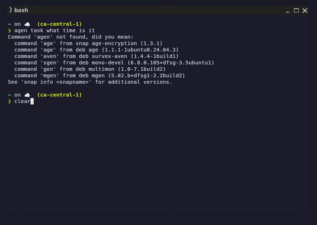

# Task Command

The `task` command enables you to describe a task you want to accomplish, and the agent will generate and execute commands to complete it.

## Usage

```sh
agent task [flags] <task description>
```

The agent will:
1. Interpret your task description
2. Generate appropriate commands to accomplish the task
3. Ask for your permission before executing any commands
4. Provide the results

The `task` command runs through an event-driven task execution path. The agent core decides what to do next, while the CLI owns terminal interaction for confirmations and clarification questions.

When task tools run long-lived foreground commands, their stdout/stderr can be streamed to the terminal while the command is still running. This live stream is controlled by the same `--print` flag as the final response: with the default `--print=true`, output is printed as soon as it is available; with `--print=false`, live tool output and the final response are both suppressed while the task still consumes the event stream internally.

If Terminal Agent cannot display live output but the process is still running, it emits a warning event that includes the process id when available. If the display event path itself is unavailable, the warning is written to logs instead.

When the selected provider does not expose dependable native tool calling, Terminal Agent can fall back to a structured JSON action protocol. The direct local `llama` provider uses this path today, so `task` works there as well, although providers with native tool APIs are generally more reliable for complex workflows.

## Examples

`agent task` is built for the moments where a normal chat answer is not enough: checking local state, calling a CLI, drafting a small script, or chaining a few shell steps while keeping you in control.



The demo above shows three small but representative flows:

- `agent task what time is it`
- `agent task --auto-approve make a simple curl request to get weather for Vancouver BC`
- `agent task --auto-approve write a script to calculate minutes left until christmas`

```sh
# List files
agent task "List all files in the current directory sorted by size"

# Find specific files
agent task "Find all .go files modified in the last week"

# Process text
agent task "Count the number of lines in all .md files"

# System information
agent task "Show me information about my CPU and memory usage"
```

## Python Automation (Native)

The task agent can draft and run Python scripts using native tools (no `cat <<EOF`), then execute them with `python3`, `python`, or `uv run python`.

### Prerequisites

- `python3` or `python` available on your PATH
- Optional: `uv` for fast, isolated execution

### Example

```sh
# Write hello.py and run it
agent task "Create hello.py that prints Hello, run it with python3"

# Use uv when available
agent task "Create hello.py that prints Hello, run it with uv run python"
```

If you need PEP 723 script mode, ask for `uv run --script` explicitly.

You will be asked to confirm each execution step, and the agent may also ask follow-up clarification questions when it needs more context. File creation and edits are performed by the agent’s native tools.

## Flags

| Flag | Short | Default | Description |
|------|-------|---------|-------------|
| `--provider` | `-p` | From config | The LLM provider to use |
| `--model` | `-m` | From config | The model ID to use |
| `--print` | `-x` | `true` | Whether to print the response to stdout |
| `--log` | `-l` | `false` | Whether to log the input and output to a file |
| `--plain` | `-k` | `false` | Render the response as plain text (no markdown) |
| `--allow` |  | `[]` | Allow actions without confirmation (repeatable, glob-based) |
| `--auto-approve` |  | `false` | Automatically approve confirmation prompts except explicit denies |
| `--timeout` |  | unlimited | Maximum duration for the whole task run (Go duration, e.g. `90s`, `15m`, `2h`); `0` means no timeout |

Action strings use a function-style format, e.g. `unix("aws login sso")` or `file_edit("README.md", operation="write")`. String values use glob matching against the full value: `*` matches any sequence, `?` matches a single character, and character classes like `[ab]` or `[a-z]` are supported. Escape glob metacharacters with `\` when you want a literal match, for example `unix("ls -d \\*/")`. To constrain keys, use `allowKeys=["region", "profile", "read*"]`, and key values can use the same glob syntax, e.g. `region="us-*"`.

Parser-verified safe Unix command sequences, such as `ls -la | grep go | wc -l` or `cd docs; find . -type f`, run without confirmation by default. Commands with redirection, unsafe shell control operators, command substitution, assignments, unknown commands, unbounded loops, or write-capable actions such as `find -delete` still require confirmation unless allowed or auto-approved.

See [Approval Logic](../approval-logic.md) for the complete confirmation and permission decision flow.

## Task Timeout

By default a task runs with **no timeout** — useful for long-running, foreground work such as monitoring (`agent task "watch CPU usage and tell me when it crosses 50%"`). The run stops only when the task completes, you cancel it (Ctrl-C), or it hits the internal max tool-call/turn limits.

Use `--timeout` to bound the whole run with a Go duration string:

```sh
# Stop the task after 15 minutes
agent task --timeout 15m "tail the log and summarize errors as they appear"

# Short bound for a quick job
agent task --timeout 90s "run the test suite and report failures"
```

Resolution order, highest priority first:

1. The `--timeout` flag (including an explicit `--timeout 0`, which forces unlimited even when a config default is set).
2. The `task_timeout` value in `~/.config/terminal-agent/config.json` (a duration string such as `"15m"`).
3. The built-in default: unlimited.

```json
{
  "task_timeout": "15m"
}
```

When a task stops because its timeout elapsed, the run fails with a distinct timeout error so it is distinguishable from tool or model failures. The resolved timeout (`"15m"` or `"unlimited"`) is recorded in the session log header so you can audit why a task stopped. Cancelling the caller's context (e.g. pressing Ctrl-C) always takes precedence over the timeout.

## Safety Features

The task command includes safety measures:

1. **Command Confirmation**: Before executing generated commands with side effects, the agent will show you the command and ask for confirmation.
2. **Limited Command Set**: Only parser-verified read-only commands are allowed to execute automatically by default.
3. **Iterative Approach**: The agent breaks down complex tasks into smaller steps, with visibility at each stage.

## Limitations

Currently, the task command has some limitations:

- Not all Unix commands are supported for automatic execution
- Some advanced operations may require manual intervention
- Direct local `llama` tasks currently use the agent-managed structured fallback rather than provider-native tool calling

## History and Logging

Using the `--log` flag will save your task and the response to the history log:

```sh
agent task --log "Create a backup of all .json files"
```

You can query your history with the `history` command.

## Task Memory

Task memory is enabled by default. Every task run contributes compact local memory records to `~/.local/share/terminal-agent/task_memory.db`, and later task iterations search those records before asking the model what to do next.

Automatic retrieval has a one second budget and returns up to five memories. The retrieved memories are advisory: the model may reuse, adapt, or ignore them depending on the current request and environment.

Memory records are ranked by usefulness:

1. `tool_success` records are preferred because they include the previous tool name, structured input, and historical output. These are the records that preserve commands such as `unix {"command":"date '+%I:%M %p %Z'"}`.
2. `task_completion` records are useful for final-answer patterns, but may not include the command that produced the answer.
3. `task_request` records are the weakest signal. They prove a similar prompt happened, but may not include an actionable command yet.

For current-state requests such as time, date, files, processes, git status, or command output, previous outputs are stale examples. The reusable part is the remembered tool input, so the agent should run the remembered command again instead of copying the old output.

The index uses SQLite FTS5 when available and falls back to lexical scoring when FTS5 is unavailable. Check the active search mode with:

```sh
agent memory task stats
```

Search memories manually with:

```sh
agent memory task search "what time is it"
```

Automatic retrieval is recorded in the per-run JSONL session log. Look for `task_memory_retrieval` records:

```sh
grep -R '"status":"task_memory_retrieval"' ~/.local/share/terminal-agent/sessions
```

Those records include the retrieval query, match count, and compact matched memories. If a remembered command was retrieved, it appears in the matched memory's `Input:` line.
